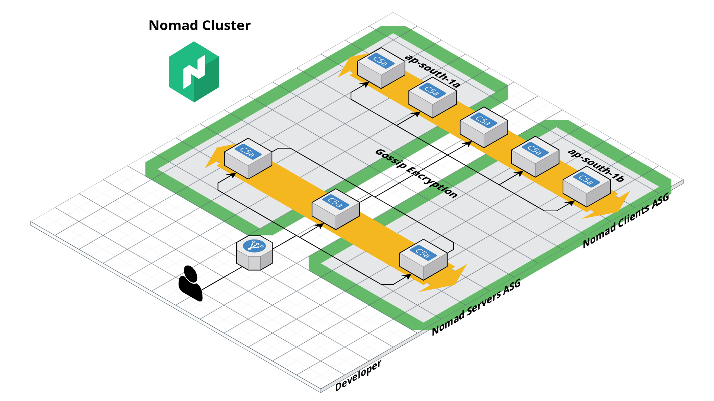

<a href="https://zerodha.tech"></a>

# Nomad Cluster Setup

Terraform modules to deploy a [HashiCorp Nomad]((https://www.nomadproject.io/)) cluster on AWS using an Auto Scaling Group (ASG). The modules are designed to provision Nomad servers and clients in ASG, making it easy to manage the infrastructure for Nomad cluster. The modules do not build images. Bring an Amazon Machine Image (AMI) that meets the [AMI](#ami) requirements.



- [Nomad Cluster Setup](#nomad-cluster-setup)
  - [AMI](#ami)
  - [Secrets](#secrets)
  - [AWS Resources](#aws-resources)
    - [Auto Scaling Group (ASG)](#auto-scaling-group-asg)
    - [Security Group](#security-group)
    - [IAM Role](#iam-role)
    - [ALB](#alb)
  - [Nomad Server](#nomad-server)
    - [Terraform Module Reference](#terraform-module-reference)
  - [Nomad Client](#nomad-client)
    - [Terraform Module Reference](#terraform-module-reference-1)
  - [Example Usage](#example-usage)
    - [Nomad Servers](#nomad-servers)
    - [Nomad Clients](#nomad-clients)
    - [Other Examples](#other-examples)
  - [Changelog](#changelog)
  - [Contributors](#contributors)
  - [Contributing](#contributing)
  - [LICENSE](#license)

## AMI

The modules boot instances from the AMI you pass as `ami` and configure Nomad with cloud-init user data. The image must have:

- systemd, cloud-init and bash.
- Nomad 1.7 or later with its systemd unit installed but not enabled, for example from the HashiCorp RPM or deb package. The generated configuration is validated against Nomad 2.1.1.
- The AWS CLI v2. Servers use it to read secrets from SSM and to upload raft snapshots when `nomad_raft_backup_bucket` is set. Clients use it only when `tls_enabled` is true.
- Docker on clients with `enable_docker_plugin = true`, the default.

The setup scripts only write under `/etc` and to the host volume paths you configure, so immutable images with a read-only `/usr`, such as bootc images, are supported. Nomad keeps its state in `/opt/nomad/data`, so `/opt/nomad` must be writable.

## Secrets

Secrets never pass through Terraform. Store them as SecureString parameters under one SSM path and pass that path as `secrets_ssm_prefix`. Instances read them at boot and write them to root-only files in `/etc/nomad.d`.

| Parameter | Read by | Required when |
|-----------|---------|---------------|
| `<prefix>/gossip_key` | servers | always |
| `<prefix>/acl_bootstrap_token` | servers | `nomad_acl_enable = true` |
| `<prefix>/tls/ca_cert`, `<prefix>/tls/cert`, `<prefix>/tls/key` | servers and clients | `tls_enabled = true` |

Servers need a certificate valid for `server.<nomad_region>.nomad`. Give clients a separate prefix with client certificates (`client.<nomad_region>.nomad`) so that a client certificate cannot act as a server.

```bash
aws ssm put-parameter --type SecureString --name /nomad/example/gossip_key --value "$(nomad operator gossip keyring generate)"
aws ssm put-parameter --type SecureString --name /nomad/example/acl_bootstrap_token --value "$(uuidgen)"
```

## AWS Resources

The key resources provisioned by this module are:

1. Auto Scaling Group (ASG)
2. Security Group
3. IAM Role
4. Application Load Balancer (ALB) (optional)

### Auto Scaling Group (ASG)

The module deploys Nomad on top of an Auto Scaling Group (ASG). For optimal performance and fault tolerance, it is recommended to run the Nomad server ASG with 3 or 5 EC2 instances distributed across multiple Availability Zones. Each EC2 instance boots from the AMI passed as `ami`, which must meet the [AMI](#ami) requirements.

### Security Group

Each EC2 instance within the ASG is assigned a Security Group that permits:

- All outbound requests
- All inbound ports specified in the [Nomad documentation](https://developer.hashicorp.com/nomad/docs/install/production/requirements#ports-used)

The common Security Group is attached to both client and server nodes, enabling the Nomad agent to communicate and discover other agents within the cluster. The Security Group ID is exposed as an output variable for adding additional rules as needed. Furthermore, you can provide your own list of security groups as a variable to the module.

### IAM Role

An IAM Role is attached to each EC2 instance within the ASG. Its inline policy allows:

- `ssm:GetParameter` and `ssm:GetParameters` on `<secrets_ssm_prefix>/*`.
- `kms:Decrypt` through SSM only, limited to `kms_key_arn` when it is set.
- `ec2:DescribeInstances` and `ec2:DescribeTags` for cloud auto-join.

Attach extra policies, such as S3 access for raft backups, with `iam_policy_arns`.

### ALB

An internal Application Load Balancer (ALB) is _optionally_ created for the Nomad servers. The ALB is configured to listen on port 80/443 and forward requests to the Nomad servers on port 4646. The ALB is exposed as an output variable for adding additional rules as needed.

## Nomad Server

The [`setup_server`](./modules/nomad-servers/scripts/setup_server.tftpl.sh) script included in this project configures and bootstraps Nomad server nodes in an AWS Auto Scaling group. The script performs the following steps:

- Writes the agent configuration to `/etc/nomad.d/{base,server,tls,secrets}.hcl` and removes the packaged `nomad.hcl`.
- Reads the gossip key, the ACL bootstrap token, and the TLS files from SSM.
- Starts Nomad. The servers use the `nomad_join_tag_value` tag to auto-join the cluster and elect a leader.
- Bootstraps ACLs with the token from SSM. Every server retries until the cluster has a leader, and the servers that lose the race see that ACLs are already bootstrapped.

### Terraform Module Reference

Check out [`nomad_servers`](./modules/nomad-servers/README.mkdn) documentation for module reference.

## Nomad Client

The [`setup_client`](./modules/nomad-clients/scripts/setup_client.tftpl.sh) script included in this project configures Nomad client nodes in an AWS Auto Scaling group. The script performs the following steps:

- Writes the agent configuration to `/etc/nomad.d/{base,client,tls}.hcl` and removes the packaged `nomad.hcl`.
- Configures the Nomad agent as a client on the EC2 instances and uses the `nomad_join_tag_value` tag to auto-join the cluster.
- Configures DNS resolution for the Nomad cluster inside `exec` driver.
- Prepares configurations for different task drivers.
- Does not drain on shutdown: a node that reboots in place would come back ineligible ([hashicorp/nomad#17093](https://github.com/hashicorp/nomad/issues/17093)). Drain a node yourself before planned maintenance.

### Terraform Module Reference

Check out [`nomad_clients`](./modules/nomad-clients/README.mkdn) documentation for module reference.

## Example Usage

### Nomad Servers

```hcl
module "nomad_servers" {
  source = "git::https://github.com/zerodha/nomad-cluster-setup//modules/nomad-servers?ref=v2.0.0"

  cluster_name         = "demo-nomad"
  cluster_tags         = { env = "demo" }
  nomad_join_tag_value = "demo"
  instance_count       = 3
  ami                  = "ami-0123456789abcdef0"
  vpc                  = "vpc-0123456789abcdef0"
  subnets              = ["subnet-0123456789abcdef0"]
  create_alb           = true
  nomad_alb_hostname   = "nomad.example.com"
  secrets_ssm_prefix   = "/nomad/example"
}
```

### Nomad Clients

```hcl
module "nomad_client_demo" {
  source = "git::https://github.com/zerodha/nomad-cluster-setup//modules/nomad-clients?ref=v2.0.0"

  cluster_name              = "demo-nomad"
  cluster_tags              = { env = "demo" }
  nomad_join_tag_value      = "demo"
  client_name               = "example-app"
  enable_docker_plugin      = true
  ami                       = "ami-0123456789abcdef0"
  instance_type             = "c6a.xlarge"
  instance_desired_count    = 10
  instance_max_count        = 10
  subnets                   = ["subnet-0123456789abcdef0"]
  secrets_ssm_prefix        = "/nomad/example"
  route_53_resolver_address = "10.0.0.2"
}
```

**NOTE:** This module does not set up an ALB for accessing applications running on Nomad Clients. This is left up to the user to configure. Check out [`terraform-aws-alb`](https://github.com/terraform-aws-modules/terraform-aws-alb) or [Other Examples](#other-examples) for more information. Set [`target_group_arns`](./modules/nomad-clients/README.mkdn#input_target_group_arns) to register the client ASG with a target group.

### Other Examples

* [Complete Cluster Setup](./examples/complete-cluster-asg)

## Changelog

See [CHANGELOG.md](./CHANGELOG.md) for a detailed list of changes across versions.

## Contributors

- [Karan Sharma](https://github.com/mr-karan)
- [Chinmay Pai](https://github.com/thunderbottom)


## Contributing

Contributions to this repository are welcome. Please submit a pull request or open an issue to suggest improvements or report bugs.


## LICENSE

[LICENSE](./LICENSE)
